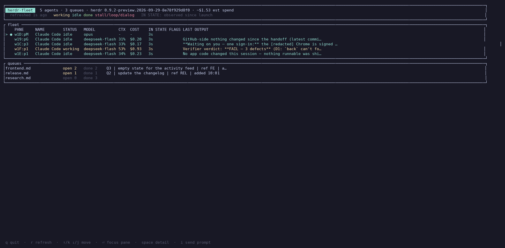

# herdr-fleet

A terminal dashboard for [herdr](https://herdr.dev) agent panes. One screen shows
every agent's status, model, context usage, estimated spend, how long it has been
in that state, its last line of output, and anything that looks stuck — plus the
open-item counts of your markdown queues.

Built for a machine that runs a fleet of Claude Code agents in herdr panes and
needs to see, at a glance, which pane needs attention.



The capture is a real run against a live fleet; the queues panel uses
[`docs/demo-queue`](docs/demo-queue) so no private checklist names are shown.

## What it shows

| Column | Meaning |
| --- | --- |
| `PANE` | herdr pane id; `●` marks the focused pane |
| `NAME` | the pane's title (or its label) |
| `STATUS` | `working` / `idle` / `done` / `blocked`, from herdr |
| `MODEL` | the model running in the pane; a fresh pane shows its launch model, or `fresh` |
| `CTX` | context used % = tokens over the context window; turns yellow at 50%, red at 80% |
| `COST` | estimated session spend at list prices (see [Cost](#cost)); header shows the fleet total |
| `IN STATE` | time in the current state, as observed since launch (`!` = past the stall budget) |
| `FLAGS` | `loop xN:` the same Bash command N times; `blocked`; `dialog:` a waiting prompt |
| `LAST OUTPUT` | the last line the agent wrote |

The `NAME`, `MODEL`, `FLAGS` and `LAST OUTPUT` columns are sized to their content,
so short names are never cut while the output column wastes width.

A `queues` panel lists every `*.md` checklist in `--queue-dir` with `open`/`done`
counts and the first open item, one line each.

## How it reads the fleet

`herdr agent read` returns pane text **clamped to the pane width**, which cuts the
status line off before `model | ctx:%` — so that is not a reliable source. Instead,
herdr-fleet follows the session id herdr reports for each Claude pane to the
session transcript under `~/.claude/projects/*/<session-id>.jsonl` and reads, from
the last assistant message:

- the **model** and its **token usage** (`input + cache_read + cache_creation`, over
  `--context-window`, default `1000000` for 1M-context models);
- the last line of assistant **text**;
- its recent `Bash` tool calls, for the **loop** flag — the full whitespace-normalised
  command counted 3+ times in the last 30 (nothing is prefix-matched, so different
  commands that share a prefix never count as one);
- every assistant turn's usage, summed for the **cost** column.

Transcripts are read **incrementally**: each file is parsed once and then only the
bytes appended since the previous refresh, so a long session costs nothing to watch.

For a Claude pane with no assistant turn yet, the model comes from the pane's launch
arguments (`herdr pane process-info`), or shows `fresh` when even that is unreadable.
For a non-Claude agent it falls back to scraping the pane text. A Claude pane with
no transcript yet shows no chrome rather than Claude's own UI. The `source` field in
`--json` output says which was used (`transcript`, `pane`, `launch` or `none`).

The pane list itself comes from `herdr api snapshot` (falling back to
`herdr agent list`). `--herdr` (or `$HERDR_BIN`) selects the executable.

## Cost

`COST` is an **estimate** at published list prices (dated 2026-10-13), computed as
`input×in + cache-read×0.1×in + cache-write×1.25×in + output×out` for Anthropic
models, and DeepSeek's off-peak rates for `deepseek-*` (its peak window — UTC
01:00–04:00 and 06:00–10:00, Mon–Fri — is 2x). It is not billing truth: subscription
panes cost nothing per token, and provider prices change. Unknown models show no
cost rather than a wrong one.

## Install

```bash
curl -fsSL https://raw.githubusercontent.com/jdgafx/herdr-fleet/main/install.sh | sh
```

That downloads the prebuilt binary for this platform from
[GitHub Releases](https://github.com/jdgafx/herdr-fleet/releases), verifies its
SHA-256, and installs it to `~/.local/bin` (`INSTALL_DIR` overrides; `VERSION` pins
a release). From source, instead:

```bash
cargo install --git https://github.com/jdgafx/herdr-fleet
# or in a checkout:
cargo install --path .
```

## Usage

```
herdr-fleet [OPTIONS] [COMMAND]

Options:
      --herdr <BIN>              herdr executable            [env: HERDR_BIN] [default: herdr]
      --queue-dir <DIR>          markdown checklists to summarise
      --claude-projects <DIR>    session transcripts          [env: CLAUDE_PROJECTS_DIR]
                                 [default: $CLAUDE_CONFIG_DIR/projects or ~/.claude/projects]
      --context-window <TOKENS>  context window for the ctx %  [default: 1000000]
      --interval <SECS>          TUI refresh interval          [default: 2]
      --stall-secs <SECS>        "working" past this = stalled [default: 900]
      --alerts                   desktop alert when a pane goes blocked/stalled/looping

Commands:
  tui            Run the interactive dashboard (default)
  list           Print one snapshot and exit  [--json]
  back           Focus the pane herdr-fleet was started in
  install-keys   Write the herdr key binding that runs `herdr-fleet back`
```

`herdr-fleet list` against a live fleet:

```
herdr-fleet · herdr 0.9.2-preview · 5 agents · ~$24.24 est spend
PANE     NAME                   STATUS   MODEL           CTX    COST  LAST OUTPUT
w1D:pM   Deepseek agents with … working  Opus 5.5        26%  $22.78  It's served from `docs/fleet/index.html` by…
w19:pG   Claude Code            done     deepseek-flash  31%   $0.20  GitHub-side nothing changed since the hando…
w1C:p3   Claude Code            working  deepseek-flash  29%   $0.09
w1F:p1   Claude Code            working  deepseek-flash  48%   $0.77  One test assertion is wrong (1.235 in f64 i…
w1E:p1   Claude Code            working  deepseek-flash  38%   $0.40  PR #83 is open. Now waiting on the Tavily s…
```

`--json` prints the same snapshot as machine-readable JSON (per-pane `cost_usd`,
`tool_calls` and the fleet `total_cost_usd` included) for scripts.

## Keys

| Key | Action |
| --- | --- |
| `q` | quit |
| `r` | refresh now |
| `↑`/`k`, `↓`/`j` | move the selection |
| `⏎` | focus the selected pane in herdr (`herdr agent focus`) |
| `space` | detail view: the pane's last 30 output lines, its queue's current item, its last 5 tool calls; `space`/`esc` closes |
| `i` | type a prompt for the selected pane (`herdr agent prompt`); `Esc` cancels |

The dashboard is **read-only by default**: it never sends keys or prompts unless
you press `⏎` or `i`. With `--alerts`, it asks herdr for a desktop notification
the first time a pane goes blocked, past its stall budget, or into a loop.

## Back to the fleet

Press `⏎` to jump to a pane, and one key brings you back:

```bash
herdr-fleet install-keys        # writes the binding, backs up config.toml,
                                # runs `herdr config check`, reloads herdr
```

That appends a `[[keys.command]]` block to `~/.config/herdr/config.toml` (after a
timestamped backup, and it is a no-op if already present) binding `prefix+f` to
`herdr-fleet back`. `--key` picks another key, `--config` another file (the check
is skipped for non-default paths), `--no-reload` skips the server reload.

`back` works because the TUI records its own pane on start (`herdr pane current`,
stored in `~/.local/state/herdr-fleet/back.json`) and focuses it again — falling
back to the pane's tab (then its workspace) when the recorded pane has no agent
to address, and exiting non-zero if the exact pane could not be focused.

## Queues

Point `--queue-dir` at any folder of markdown checklists. Each `*.md` file is
summarised by its `- [ ]` (open) and `- [x]` (done) lines; nothing about the
format is herdr- or project-specific.

## Limitations

- **COST** is a list-price estimate (see [Cost](#cost)); treat it as a signal, not
  an invoice.
- **IN STATE** is counted from when herdr-fleet first sees a pane in a state, not
  from herdr's own state-change time (herdr exposes a sequence number, not a
  timestamp). It is labelled as observed-since-launch for that reason.
- The `CTX` percentage is only as good as `--context-window`. It defaults to
  1,000,000 (the 1M-context models this was built against).
- Pane text is read only for non-Claude agents, where it is clamped to the pane
  width — so their `MODEL`/`CTX` are usually blank. The status line (even
  truncated) and the input box are filtered out of their `LAST OUTPUT`.
- A fresh Claude pane shows its launch model (or `fresh`) until its first
  assistant turn lands in the transcript.
- The loop and dialog detectors are heuristics: one repeated Bash command in the
  recent transcript (compared in full), and a small set of approval-dialog
  phrases in pane text.

## Development

```bash
cargo fmt --all -- --check
cargo clippy --all-targets -- -D warnings
cargo test
```

CI runs all three, plus a release build, on every push and pull request. Pushing
a `v*` tag builds prebuilt binaries for Linux (x86_64, aarch64) and macOS (arm64)
and attaches them, with SHA-256 checksums, to the GitHub Release.

`scripts/screenshot.sh` regenerates the image above from a real run via tmux.

## License

MIT — see [LICENSE](LICENSE).
